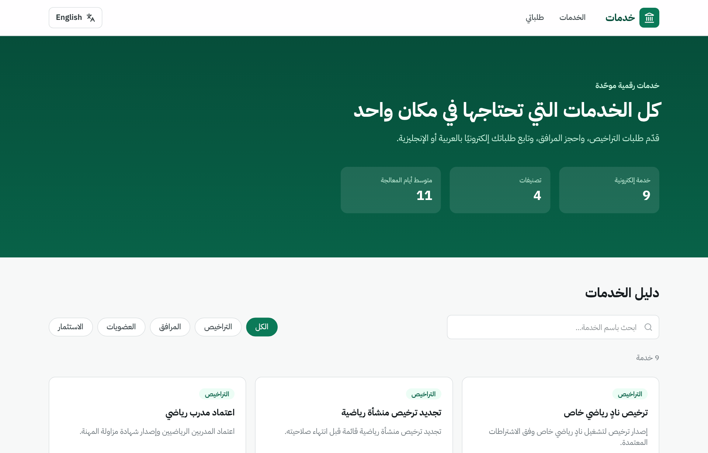
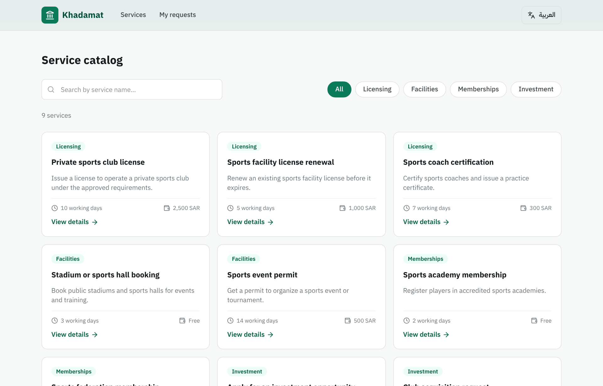
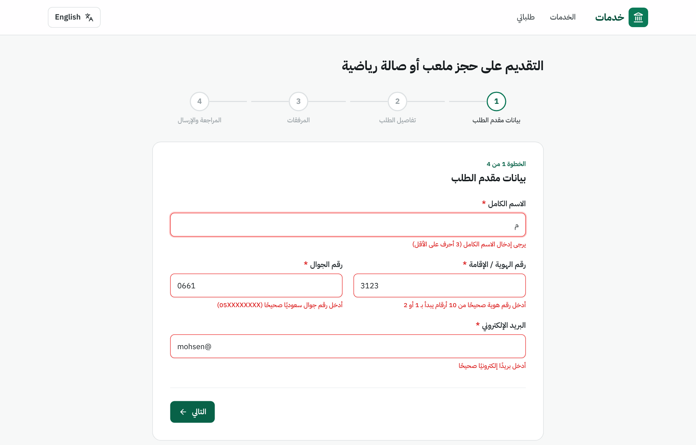
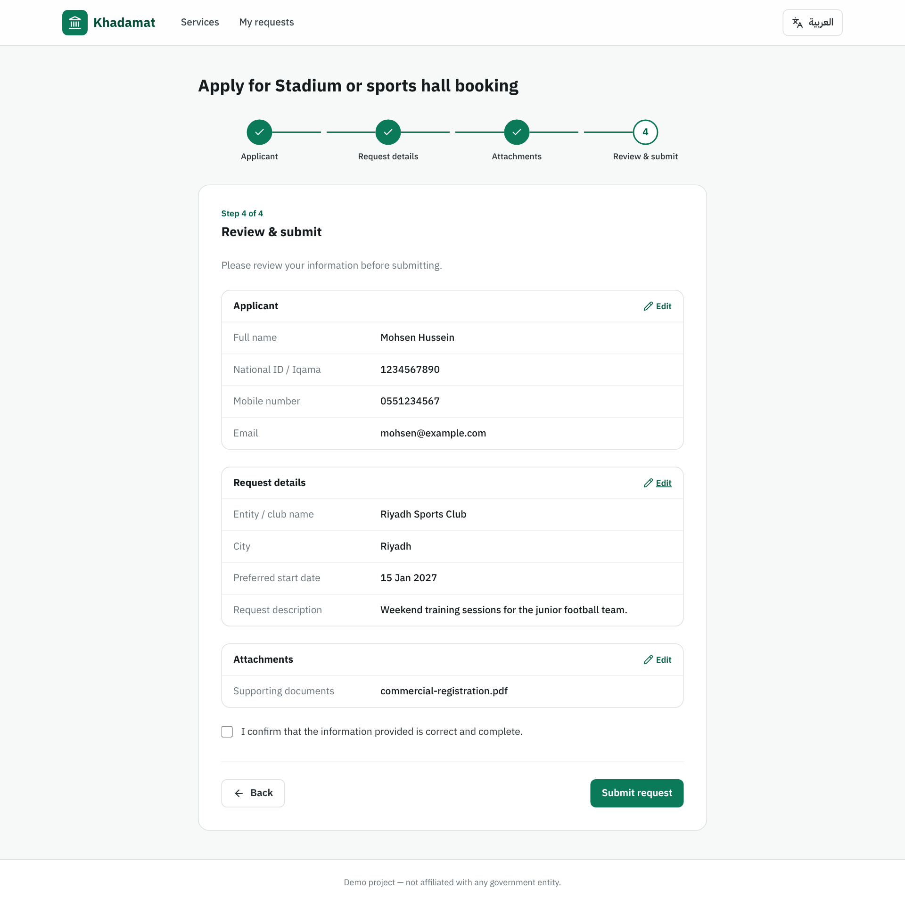
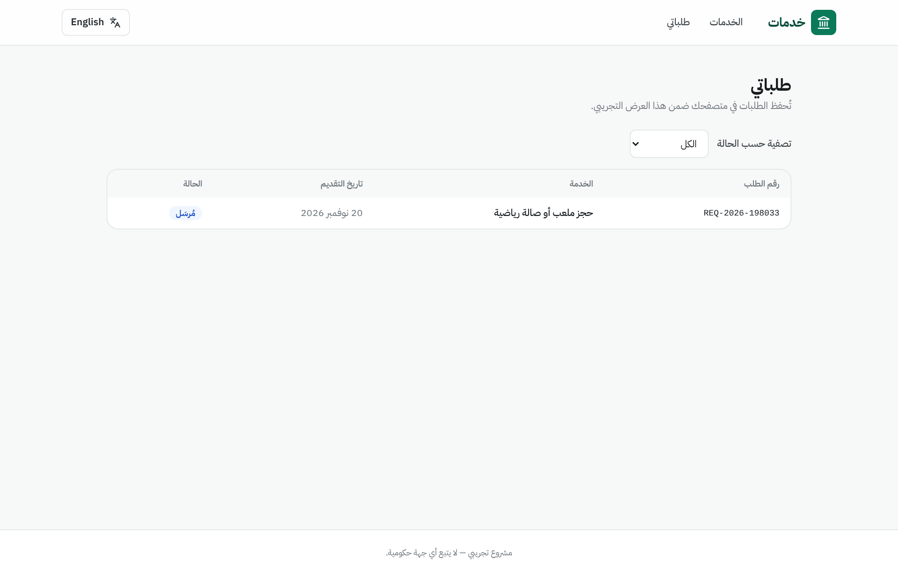
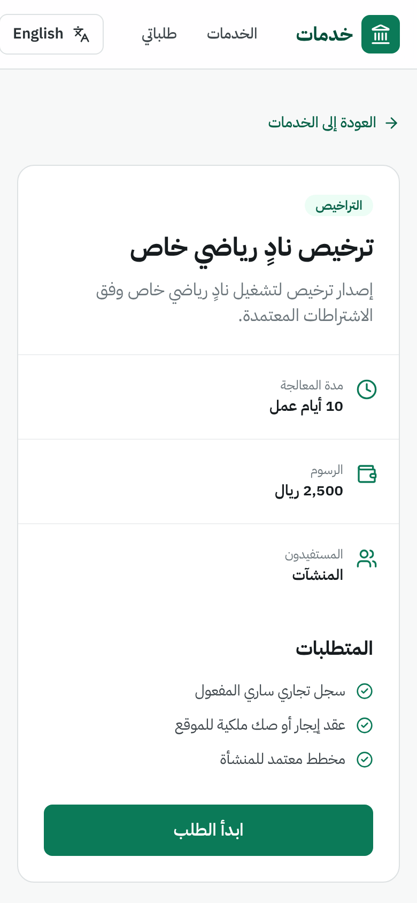

<div align="center">

# Khadamat · e-Services Portal

**A bilingual (Arabic / English) government-style e-services portal built with Next.js 16, TypeScript and Tailwind CSS.**

Arabic-first RTL layout · Multi-step application wizard · Accessible forms · Tested

[](https://github.com/Mohsen-Hussen/eservices-portal/actions/workflows/ci.yml)




</div>

## Why this project

Large government portals have the same core building blocks: a service catalog, a service details page, a multi-step application, and a place to track requests. All of it has to work in Arabic **and** English with correct right-to-left layout.

This repository is a compact, production-style version of that pattern. I built it to show the architecture and the details I care about when I build these portals at scale.

> This is a demo project. It is not affiliated with any government entity, and all services and data are fictional.

## Features

- **Arabic-first i18n with real RTL.** Locale-based routing (`/ar`, `/en`), with `lang`/`dir` set on `<html>`. The UI uses CSS logical properties (`ms-*`, `ps-*`, `start-*`) instead of left/right, and directional icons flip automatically. A `proxy.ts` redirects `/` based on `Accept-Language`.
- **Typed dictionaries.** Translations are JSON files typed from the English source and loaded on the server only. A test fails the build if Arabic and English drift apart, including the `{placeholders}`.
- **Searchable service catalog.** Search works across both languages and can be combined with category filters (`aria-pressed` chips, live result count).
- **4-step application wizard** built with **React Hook Form + Zod**:
  - Each step is validated before moving on: Saudi national ID/Iqama, mobile number (`05XXXXXXXX`), email, future dates, and file type/size/count.
  - Schemas return **message keys** instead of text, so one schema serves both languages and stays easy to unit-test.
  - Errors appear on blur, then clear as soon as the value is fixed.
  - A review step lets you edit any section, and a declaration must be accepted before submitting.
- **Request tracking.** Submitted requests are kept in a small store backed by `localStorage` through `useSyncExternalStore`. The table can be filtered by status, and it syncs across browser tabs.
- **Accessibility.** There's a skip link and labelled controls. Hints and errors are wired with `aria-describedby`/`aria-invalid` and announced with `role="alert"`. Focus moves to the new step heading, and the stepper uses `aria-current="step"`.
- **Static by default.** All locale and service pages are pre-rendered with `generateStaticParams`.

## Screenshots

| Service catalog (English)                                                      | Validation (Arabic, RTL)                                                           |
| ------------------------------------------------------------------------------ | ---------------------------------------------------------------------------------- |
|  |  |
| **Review & submit**                                                            | **My requests**                                                                    |
|                  |       |

<p align="center"></p>

## Tech stack

| Area      | Choice                                                                                |
| --------- | ------------------------------------------------------------------------------------- |
| Framework | Next.js 16 (App Router, Cache Components, `proxy.ts`) · React 19                      |
| Language  | TypeScript (strict)                                                                   |
| Styling   | Tailwind CSS 4 with design tokens in `@theme`, IBM Plex Sans Arabic                   |
| Forms     | React Hook Form 7 · Zod 4 · `@hookform/resolvers`                                     |
| Testing   | Jest 30 · React Testing Library · user-event                                          |
| Quality   | ESLint (`eslint-config-next`) · Prettier with the Tailwind plugin · GitHub Actions CI |

## Project structure

```
src/
├── app/[lang]/                 # every route lives under the locale segment
│   ├── layout.tsx              # <html lang dir>, header, metadata
│   ├── page.tsx                # hero + service catalog
│   ├── services/[slug]/        # service details
│   │   └── apply/              # application wizard
│   └── requests/               # request tracking
├── components/
│   ├── ui/                     # Button, Field/Input/Select/Textarea, Badge, Stepper
│   ├── application-wizard.tsx
│   ├── service-catalog.tsx
│   └── requests-table.tsx
├── i18n/                       # locales, typed dictionaries, formatting, locale detection
├── lib/                        # services data, Zod schemas, requests store
├── proxy.ts                    # locale redirect
└── __tests__/                  # unit + component tests
```

## Getting started

Requires Node.js 20.9+.

```bash
git clone https://github.com/Mohsen-Hussen/eservices-portal.git
cd eservices-portal
npm install
npm run dev        # http://localhost:3000 → redirects to /ar or /en
```

| Script              | What it does                                |
| ------------------- | ------------------------------------------- |
| `npm run dev`       | Start the dev server                        |
| `npm run build`     | Production build                            |
| `npm test`          | Run the Jest test suite                     |
| `npm run lint`      | ESLint                                      |
| `npm run typecheck` | Generate route types and run `tsc --noEmit` |
| `npm run format`    | Format with Prettier                        |

## Testing

There are 32 tests covering:

- Zod schemas: every validation rule and its error key.
- i18n: Arabic/English key parity, matching placeholders, path switching and `Accept-Language` detection.
- The catalog: search across both languages, category filters and the empty state.
- The wizard: blocking invalid steps, clearing errors, and the full flow from step 1 to a stored request.
- The requests store: ordering, stable snapshots for `useSyncExternalStore`, and recovery from corrupted storage.

## License

[MIT](LICENSE) © Mohsen Hussein
